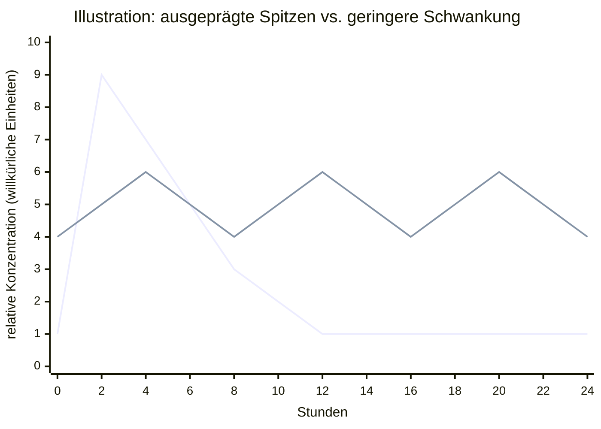

# 002 | Transdermale Estradiol-Regulation: kontinuierlicher, zielorientierter Forschungsansatz

**Stand:** 12. Oktober 2026  
**Status:** Konzeptionelles Forschungsmodell; keine klinisch validierte Therapie oder Dosierungsanleitung.

## Zielsetzung

Untersucht wird ein physiologisch orientierter Ansatz der feminisierenden Hormontherapie, der die hormonelle Regulation als zusammenhängenden Prozess betrachtet. Das Forschungsziel ist eine möglichst gut steuerbare feminisierende Entwicklung **ohne routinemäßige zusätzliche pharmakologische Androgenrezeptorblockade**, sofern sich dies unter klinischer Kontrolle als wirksam und sicher erweist. Die Wirkung von Estradiol auf die Hypothalamus-Hypophysen-Gonaden-Achse und auf die gonadische Steroidogenese steht im Mittelpunkt. Die Vermeidung eines Antiandrogens ist eine zu prüfende Option, kein allgemein geeigneter Standard.

Die angestrebte Entwicklung wird mit hormonabhängigen Veränderungen während der Pubertät verglichen. Eine Pubertät ist jedoch kein gleichförmiger oder sinusförmiger Hormonverlauf; individuelle, zeitliche und entwicklungsbiologische Unterschiede sind zu berücksichtigen. Ein solches Vergleichsmodell ersetzt keine klinische Evidenz.

## Transdermale Anwendung und hepatischer First-Pass-Effekt

Bei transdermaler Estradiolaufnahme gelangt der Wirkstoff durch die Haut in den systemischen Kreislauf und umgeht die initiale Aufnahme aus dem Darm über die Pfortader in die Leber. Dadurch entfällt der **ausgeprägte initiale hepatische First-Pass-Effekt** der oralen Aufnahme. Die Leber verstoffwechselt Estradiol weiterhin bei späteren Kreislaufpassagen; „Umgehung“ bedeutet nicht, dass kein Leberstoffwechsel stattfindet.

Die tatsächliche Aufnahme hängt unter anderem von Formulierung, Applikationsstelle, Hautzustand, Auftragsfläche und Zeit ab. Besonders die Übertragung von Daten zu skrotal angewendetem Testosteron auf Estradiol ist nicht ohne gesonderte Messungen zulässig. Siehe [S-002](003-Studien.md#s-002--iyer-et-al-2017) und [S-004](003-Studien.md#s-004--offene-forschungsfrage-applikationsort-von-estradiol).

## Forschungsfrage: zeitliche Verteilung und Acht-Stunden-Intervall

**Zu prüfende Hypothese:** Eine über den Tag verteilte transdermale Estradiol-Exposition könnte gegenüber einer stärker schwankenden Exposition Unterschiede in Konzentrationsspitzen, Talspiegeln, hormoneller Rückkopplung und Verträglichkeit aufweisen.

Ein **Acht-Stunden-Intervall** wird als vom Forschungsansatz vorgeschlagener Vergleichsparameter dokumentiert, **nicht als empfohlene Einnahme- oder Auftragsfrequenz**. Ob ein solches Intervall bei einem konkreten Präparat überhaupt sinnvoll ist, kann nur anhand seiner Pharmakokinetik, der Gesamtbelastung und klinischer Daten beurteilt werden. Häufigere Anwendung kann zu Kumulation und unerwartet hohen Estradiolspiegeln führen.

**Zu messende Größen:** Estradiol-Konzentrationsverlauf über 24 Stunden, Spitzen- und Talspiegel, Fläche unter der Konzentrations-Zeit-Kurve (AUC), Estron/Estradiol-Verhältnis, Testosteron, LH/FSH, individuelle Variabilität und Sicherheitsparameter. Entscheidend sind kontrollierte Vergleiche bei vergleichbarer Gesamtexposition, nicht allein die Zahl der Anwendungen.

## Konzeptionelles 24-Stunden-Diagramm

Die folgende Skizze zeigt **nur zwei idealisierte Kurvenformen**, keine gemessenen Estradiolwerte, keine klinische Zielkurve und keine Berechnung für ein bestimmtes Präparat. Der Ausdruck „Sinuskurve“ dient hier als anschauliche Beschreibung kleinerer periodischer Schwankungen, nicht als behauptete tatsächliche Pharmakokinetik.

**Lesart:** Die erste Linie veranschaulicht eine hohe frühe Spitze mit anschließendem Abfall; die zweite Linie veranschaulicht geringere Schwankungen oberhalb der Null-Linie. Die Linien sind **nicht** als äquivalente AUC, reale Pharmakokinetik, sichere Konzentrationsbereiche oder Wirksamkeitsnachweis zu interpretieren. Insbesondere kann man aus einer grafisch gleichmäßigeren Kurve nicht automatisch auf bessere Feminisation oder geringere Risiken schließen.

## Steroidogenese, Aromatase und Temperatur

Aromatase (CYP19A1) katalysiert insbesondere die Umwandlung **von Testosteron zu Estradiol (E2)** und **von Androstendion zu Estron (E1)**. Estriol (E3) entsteht über weitere Stoffwechselwege und ist kein direktes Standardprodukt der Aromatase aus Testosteron.

Die Enzymreaktion ist molekular und damit letztlich quantenmechanisch beschreibbar. Temperatur beeinflusst allgemein Reaktionskinetik und Proteinfunktion; daraus folgt jedoch **nicht**, dass eine lokale Temperaturänderung in Gonadengewebe nachgewiesenermaßen über einen spezifischen Quantentunneleffekt die Aromataseaktivität gezielt steigert. Diese mögliche Verbindung wird als **offene mechanistische Hypothese** geführt, für die direkte experimentelle Daten fehlen.

## Testosteronregulation ohne zusätzliche Blockade

Estradiol kann die gonadotrope Rückkopplung und damit die Testosteronproduktion beeinflussen. Zusätzlich wurden direkte Effekte auf steroidogenes Hodengewebe unter experimentellen Bedingungen beschrieben ([S-001](003-Studien.md#s-001--vaucher-et-al-2014)). Daraus folgt aber nicht, dass eine bestimmte transdermale Applikation bei allen Personen ohne Antiandrogen eine ausreichende Testosteronsuppression erreicht.

Die Forschungsfrage lautet daher, **unter welchen Bedingungen** eine feminisierende Therapie ohne zusätzliches Antiandrogen klinisch ausreichend wirksam und verträglich sein könnte, ohne hohe Estradiolspiegel als Ersatz für eine Blockade vorauszusetzen.

## Referenzverknüpfung und offene Prüfung

- [S-001](003-Studien.md#s-001--vaucher-et-al-2014): experimentelle Estradiolwirkung auf Testosteronproduktion.
- [S-002](003-Studien.md#s-002--iyer-et-al-2017): skrotale Aufnahme von Testosteron, nicht Estradiol.
- [S-004](003-Studien.md#s-004--offene-forschungsfrage-applikationsort-von-estradiol): ortsabhängige Estradiolwirkung als offene Hypothese.
- [R-004](003-Studien.md#r-004--nichtgleichgewichts-thermodynamik-und-biochemische-netzwerke): Energieflüsse und chemische Prozesse.
- [R-006](003-Studien.md#r-006--quantenbiologie-und-mikroskopische-prozesse): quantenbiologische Forschungsfragen.

Noch zu ergänzen sind direkt einschlägige klinische Originalarbeiten zu transdermaler Estradiol-Pharmakokinetik, Estradiol-Monotherapie, Aromatase und pubertären Hormonverläufen. Bis dahin sind keine konkreten Wirksamkeits- oder Sicherheitsversprechen ableitbar.

**Sicherheit:** Dies ist keine Anleitung zur selbstständigen Änderung von Präparat, Dosierung oder Anwendungshäufigkeit. Die klinische Steuerung einer Hormontherapie erfordert ärztliche Begleitung und geeignete Kontrollen.

**Lizenz:** [PORL v1.0](004-Lizenz.md).
